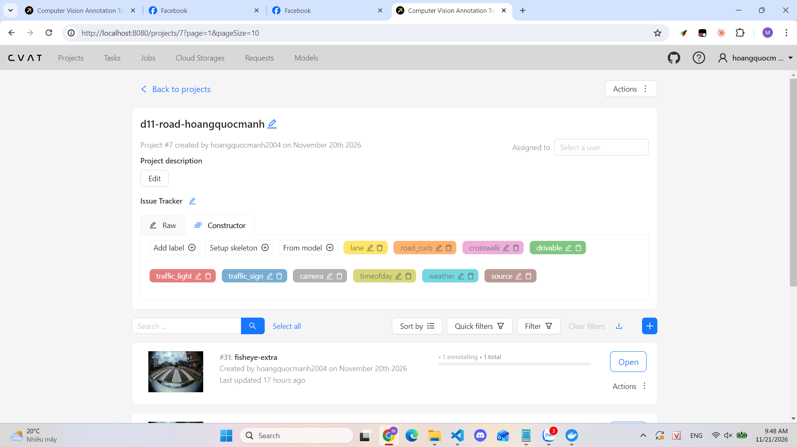
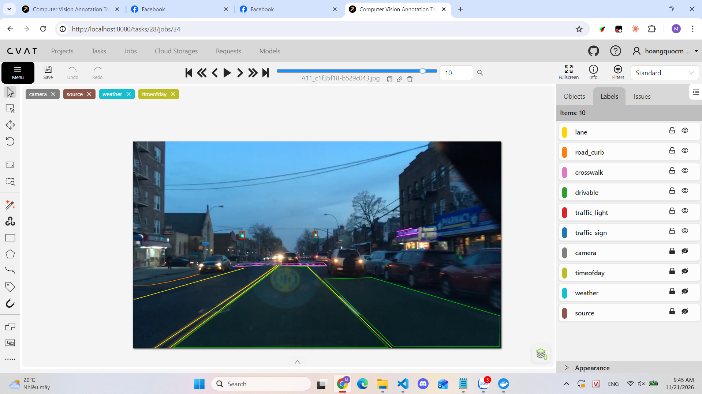
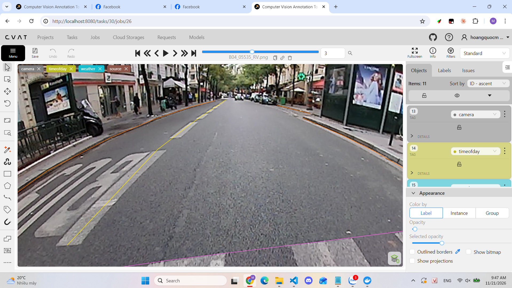

# Báo cáo cá nhân — Ngày 11
Họ tên: Hoàng Quốc Mạnh               Mã học viên: 03219  
Phiên bản CVAT (Help → About): 2.82.0 (CVAT local)  
Guideline: Road v1.0    Lần nộp (`revision` trong manifest): 1  
Thời điểm export (ngày giờ trên CVAT): 20/11/2026, front 11:22 UTC, front-extra 16:30 UTC, fisheye 16:25 UTC, fisheye-extra 15:37 UTC    Số lần nộp lại sau Rework: 0  


## 1. Kiểm project
| Mục | Đúng như guideline Road v1.0? | Ghi chú |
| --- | --- | --- |
| 6 label, đúng kiểu | Đúng | lane, road_curb (polyline); crosswalk, drivable (polygon); traffic_light, traffic_sign (rectangle). So với `python -m road_lab.taxonomy` không khác. |
| Thuộc tính và giá trị | Đúng | Khớp từng thuộc tính và giá trị với `configs/road_v1_labels.json`. |
| 4 tag ảnh | Đúng | camera, timeofday, weather, source; mỗi label kiểu Tag có một thuộc tính select `value`. |

Cách kết thúc polyline trên bản CVAT này: click các điểm từ gần xe ra xa, bấm phím **N** để kết thúc. Sau đó mở Details để sửa thuộc tính, vì polyline mới luôn mang mặc định `L1 / solid / white / single`.  
Cách đặt tag ảnh trên bản CVAT này: dùng công cụ **Tag** ở thanh bên trái, chọn label (camera trước tiên), rồi mở Details trong bảng Objects để chọn `value`. CVAT tự điền giá trị đầu danh sách (ví dụ `weather = clear`), nên phải kiểm lại từng tag.

## 2. Số lượng đã gán
| Task | Ảnh | lane | road_curb | crosswalk | drivable | traffic_light | traffic_sign |
| --- | ---: | ---: | ---: | ---: | ---: | ---: | ---: |
| front | 12 | 35 | 19 | 5 | 24 | 29 | 27 |
| front-extra (đã làm 4 / 4) | 4 | 11 | 6 | 5 | 8 | 7 | 13 |
| fisheye | 8 | 9 | 20 | 11 | 12 | 8 | 7 |
| fisheye-extra (đã làm 4 / 4) | 4 | 0 | 6 | 5 | 6 | 0 | 0 |

## 3. Bảng ca khó
| Ảnh | Nhãn | Phân vân giữa | Đã chọn | Lý do |
| --- | --- | --- | --- | --- |
| A05 | lane L1, R1 | vẽ L1/R1 hay không vẽ | không vẽ | Không thấy vạch sơn hai bên làn đang đi. Theo hướng dẫn mục 6, không vẽ vạch mà ảnh không có; nhờ coach xác nhận để miễn QC1-02. |
| A09 | lane R1 | vẽ R1 hay không vẽ | không vẽ | Bên phải xe là vỉa hè, không có vạch sơn; đã vẽ `road_curb` cho mép đường. L1 là vạch trắng đứt bên trái xe. |
| A06, A12 | traffic_light (đèn đi bộ) | `off` / `green` / `unknown` | `off` | Đèn đang sáng hình người đi bộ màu trắng; Road v1.0 không có giá trị cho tín hiệu "walk" trắng; chọn `off` vì không có ô đèn màu nào sáng. |
| A04, A06, A09, A11 | lane (vạch đôi) | một polyline `kind = double` hay hai polyline | hai polyline (sẽ sửa thành một) | Lúc gán tôi vẽ mỗi nét một đường. Sau khi kiểm lô bạn Dũng, tôi thấy guideline cần một polyline `kind = double`. |
| B05–B08, B10, B11 | tag weather | `clear` / `overcast` / `other` | `other` | Camera hai bên và camera sau gần như không thấy bầu trời nên không xác định được quang hay âm u; mặt đường khô nên không phải `rain`. |
| B05–B08 | lane position | L1/R1 hay `other` | sẽ sửa thành `other` | Guideline mục 4: ở fisheye_left và fisheye_right luôn dùng `position = other`. |

## 4. Phiếu QC 1 nhận được
Bạn kiểm lô của tôi: Nguyễn Mạnh Dũng  Quyết định nhận được: Rework  
| Mã lỗi | Số lỗi | Đồng ý? | Đã sửa? |
| --- | ---: | --- | --- |
| QC1-01 | 1 | Đồng ý với A09 thiếu bốn tag. Không đồng ý với `weather = other` ở fisheye: camera hai bên và camera sau gần như không thấy trời, mặt đường khô, đã ghi ở bảng ca khó (mục 3). | Đã sửa A09 (đủ bốn tag trong file nộp) |
| QC1-02 | 3 | Không đồng ý ở A05 và A09: bên không vẽ là vỉa hè, không có vạch sơn; theo hướng dẫn CVAT mục 6 không vẽ vạch mà ảnh không có. Đã nhờ coach xác nhận để miễn. | Không cần sửa |
| QC1-03 | 7 | Đồng ý: lane ở B05–B08 phải là `position = other` (guideline mục 4). | Sửa trong buffer |
| QC1-05 | 2 | Đồng ý: vạch đôi bị vẽ thành hai polyline; phải là một polyline `kind = double`. | Sửa trong buffer |
| QC1-08 | 3 | Không đồng ý với đèn đi bộ A06, A12 gán `off`: Road v1.0 không có giá trị cho tín hiệu "walk" trắng, đã ghi ở bảng ca khó. | Không cần sửa |
| QC1-09 | 5 | Đồng ý: sai `group` / `facing` của biển, ví dụ biển ONE WAY ở A06 phải là `mandatory`, không phải `information`. | Sửa trong buffer |
| QC1-11 | 2 | Đồng ý: bật `edge_zone` cho đèn, biển ở rìa B02–B04 và thêm điểm theo cung cho `road_curb` ở B03–B05. | Sửa trong buffer |

## 5. Kiểm file export
| File | Mở lại được? | Số shape ảnh 1 (job / file) | Số shape ảnh 2 (job / file) | Tag camera có trong XML? |
| --- | --- | --- | --- | --- |
| hoangquocmanh-front.zip | Có (`road_check lint` đọc được 16 ảnh) | A01: 10 / 10 | A02: 7 / 8 (*) | Có (`camera = front`, 16/16 ảnh) |
| hoangquocmanh-fisheye.zip | Có (`road_check lint` đọc được 12 ảnh) | B01: 5 / 5 | B02: 5 / 5 | Có (fisheye_front / rear / left / right, 12/12 ảnh) |

Cột "job" đếm trên CVAT local: job 24 (task front) và job 26 (task fisheye), project #7.  
(*) A02 lệch 1 shape: bản cuối của A01–A08 được làm trên máy mượn (job 25 ở đó có 8 shape cho A02, đúng bằng file nộp). Job 24 trên máy tôi còn giữ bản cũ của A02 với 7 shape. File nộp là bản cuối.

Manifest `hoangquocmanh-manifest.json`: revision 1, `contains_images = false` cho cả hai file, 28/28 ảnh đủ bốn tag, 0 ảnh chưa có nhãn.

## 6. Ảnh chụp màn hình
1. Tab Labels của project.  
   
2. Một ảnh camera trước đã gán đủ (làn, vùng lái, đèn/biển).  
   
3. Một ảnh fisheye đã gán, phóng to đoạn polyline cong.  
   
4. Một đoạn XML có <polyline label="lane">.

```xml
<polyline label="lane" source="manual" occluded="0" points="660.72,681.50;579.55,626.81;532.24,594.41;509.16,577.37;488.84,563.90;475.08,554.51;458.10,541.27;445.09,532.53;427.01,520.61" z_order="0">
  <attribute name="position">R1</attribute>
  <attribute name="style">dashed</attribute>
  <attribute name="color">white</attribute>
  <attribute name="kind">single</attribute>
</polyline>
```
(A01, `hoangquocmanh-front.zip`)

## 7. Tự đánh giá
Lỗi bạn mắc nhiều nhất hôm nay (theo mã QC1-xx), và cách tránh ở Ngày 20:  
QC1-03 trên fisheye: 7 lane ở camera hai bên (B05–B08) mang L1/R1 thay vì `other`. Lý do là tôi không sửa giá trị mặc định `L1` của CVAT sau khi vẽ. Lỗi thứ hai là QC1-05: vạch đôi bị vẽ thành hai polyline. Ở Ngày 20 tôi sẽ mở Details ngay sau mỗi polyline, và chạy `road_check lint` sau mỗi 4 ảnh thay vì chỉ chạy lúc cuối.

Nhãn của bạn đi vào model ở đâu? Chọn một lỗi đã sửa và nói nó làm model học sai thế nào:  
Polyline làn là đích (target) của model nhận diện làn kiểu row-anchor: mỗi hàng ảnh model học một tọa độ x cho từng vị trí L1/R1/L2/R2, và hệ thống giữ làn (LKA) dùng L1/R1 để tính độ lệch tâm làn. Nếu vạch đôi bị vẽ thành hai polyline cùng position, cùng một hàng ảnh có hai đích x khác nhau cho một vạch, nên model học nhiễu và vị trí vạch dự đoán bị kéo lệch. Còn với lỗi position ở camera hai bên, model sẽ học rằng camera bên cũng có "làn trái / làn phải của xe", và gán vạch sai làn khi ghép ảnh 360°.

## 8. (Tùy chọn, buffer) Từ polyline đến đích row-anchor
Ảnh A01, vạch R1 (`python -m road_lab.rowanchor hoangquocmanh-front.zip --image A01 --position R1`):

| y | 720 | 680 | 640 | 600 | 560 |
| --- | ---: | ---: | ---: | ---: | ---: |
| x của chúng tôi | không có làn | 658.5 | 599.1 | 540.4 | 483.1 |
| x của bạn kia |  |  |  |  |  |

Trả lời 3 câu:

1. Polyline R1 của tôi bắt đầu ở y = 681,5 nên hàng 720 đã là "không có làn". Nếu dừng sớm 40 px ở đầu xa (điểm cuối y = 520,6 → khoảng 560,6), hàng 560 sẽ thành "không có làn". Nếu bỏ 40 px ở đầu gần, hàng 680 cũng mất.
2. 
3. Không đổi: script nội suy tuyến tính giữa hai điểm kẹp mỗi hàng nên thứ tự điểm không ảnh hưởng kết quả. Script gặp khó là các bước dựa vào điểm đầu là điểm gần xe nhất, ví dụ kiểm tra chiều vẽ trong `road_check` (QC1-04) và các model hoặc bộ chuyển đổi coi điểm đầu là gốc làn.
